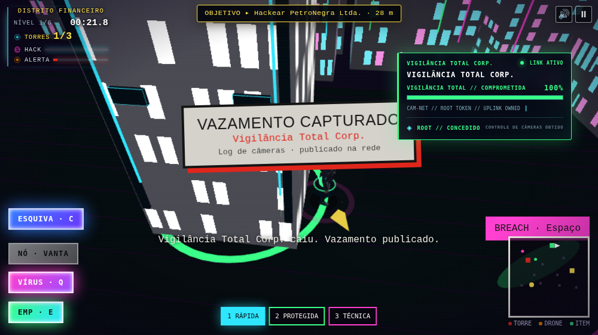
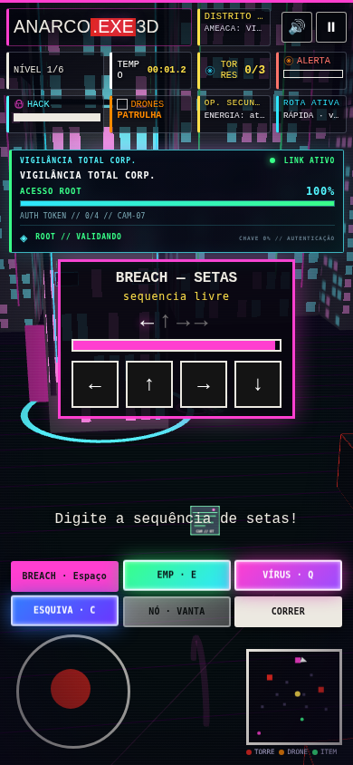
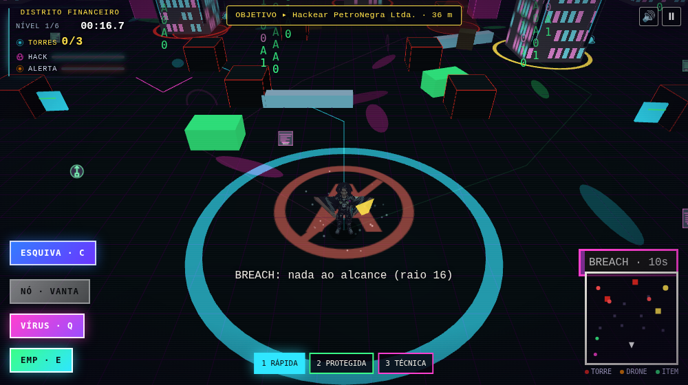

# ANARCO.EXE 3D — Upgrade v4.0.0: Vigilância Total

## Escopo entregue

- Redesenho da torre Vigilância Total Corp. com placas de blindagem, conduítes verticais, antena/beacon de datacenter e placa identificadora.
- Núcleo ciano pulsante ao lado das torres, aro horizontal e vertical, pedestal e feixe de uplink. O círculo de hack recebeu um estado luminoso de conexão.
- HUD contextual que aparece no raio de invasão, acompanha o alvo no desktop e se compacta acima do minigame em telas touch. Estados: `CONEXÃO ESTABELECIDA`, `EXTRAINDO DADOS`, `ACESSO ROOT`, falha de autenticação/glitch e `VIGILÂNCIA TOTAL // COMPROMETIDA`.
- Partículas 3D percorrem o link entre o núcleo e o personagem; a densidade acompanha o progresso. Após uma sequência incorreta, partículas e interface jitteram e ficam magenta.
- Trilha instrumental cyberpunk original (aprox. 118 s) em loop e quatro efeitos locais: conexão, fluxo de dados, erro de sequência e acesso root. Os sons usam o barramento/master existente e respeitam o mute; a síntese original permanece como fallback.
- Os cinco MP3 entram no pré-cache do service worker para uso offline após a primeira visita.
- A chuva de códigos do especial BREACH fica ativada por padrão no desktop. O menu oferece `Ativa`, `Automática` (respeita a preferência do sistema) e `Desativada`, com escolha persistente; o modo explícito permite ver os códigos mesmo quando o sistema solicita movimento reduzido.

## Capturas do fluxo

Estado de acesso root concluído em desktop:

Painel touch acima da sequência, sem cobrir as ações inferiores:

Chuva de códigos visível após ativar BREACH no desktop:

## Arquivos centrais alterados

`index.html`, `style.css`, `script.js`, `public/sw.js`, `scripts/smoke.mjs`, `scripts/e2e-invadir.mjs`, `README.md`, `package.json`, documentação e `assets/audio/*.mp3`. As regras centrais de movimento, progressão, controles, ranking e demais fases permanecem no runtime existente.

## Validação executada

| Verificação | Resultado |
|---|---|
| `node --check script.js` e `node --check public/sw.js` | Aprovado |
| `pnpm test` | 12 arquivos; 79 testes aprovados |
| `pnpm build` | Aprovado; typecheck, Vite, cópia dos assets e limite de tamanho |
| `pnpm smoke` | Aprovado; 39 arquivos estáticos, modelos e áudio local na `dist/` |
| `CHROMIUM_PATH=/usr/bin/chromium pnpm e2e` | Aprovado; seis fases, chuva BREACH com movimento reduzido, conexão/progresso/root, falha magenta, áudio, reflow mobile, botões touch e ausência de erros JS/HTTP |

A compilação mantém somente o aviso conhecido do script clássico legado `assets/dados/manifesto.js`, intencional no projeto. O breakpoint mobile foi exercitado em Chromium touch a 390 × 844 px; não substitui a verificação em aparelhos físicos. Os MP3 são pré-cacheados pelo service worker, portanto a disponibilidade offline ocorre após a primeira instalação/cache.
