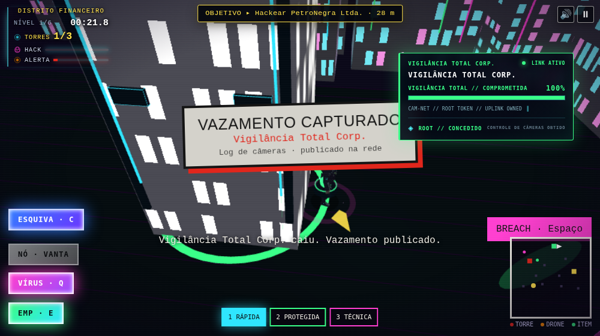
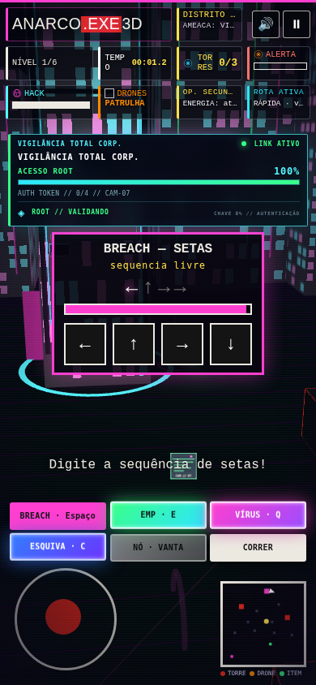
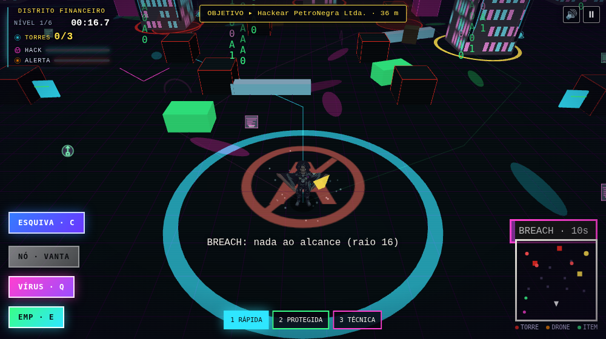
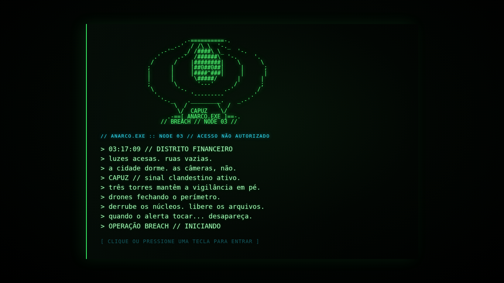
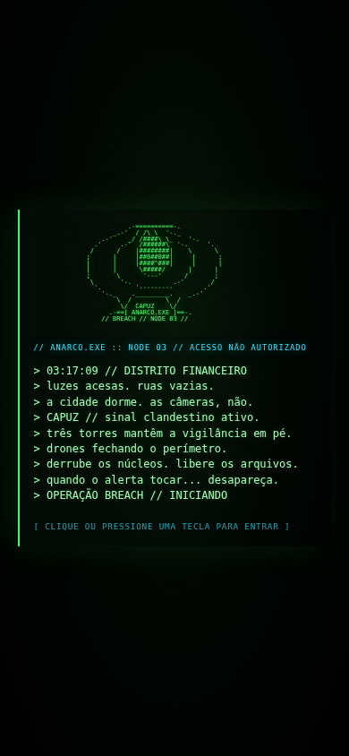

# ANARCO.EXE 3D — Upgrade v4.0.0: Vigilância Total

## Escopo entregue

- Redesenho da torre Vigilância Total Corp. com placas de blindagem, conduítes verticais, antena/beacon de datacenter e placa identificadora.
- Núcleo ciano pulsante ao lado das torres, aro horizontal e vertical, pedestal e feixe de uplink. O círculo de hack recebeu um estado luminoso de conexão.
- HUD contextual que aparece no raio de invasão, acompanha o alvo no desktop e se compacta acima do minigame em telas touch. Estados: `CONEXÃO ESTABELECIDA`, `EXTRAINDO DADOS`, `ACESSO ROOT`, falha de autenticação/glitch e `VIGILÂNCIA TOTAL // COMPROMETIDA`.
- Partículas 3D percorrem o link entre o núcleo e o personagem; a densidade acompanha o progresso. Após uma sequência incorreta, partículas e interface jitteram e ficam magenta.
- Trilha instrumental cyberpunk original (aprox. 118 s) em loop e quatro efeitos locais: conexão, fluxo de dados, erro de sequência e acesso root. Os sons usam o barramento/master existente e respeitam o mute; a síntese original permanece como fallback.
- Áudio sob demanda: os cinco MP3 só são baixados depois de `Invadir`/Tutorial; se o jogador estiver com Mudo ativado, a busca aguarda até desmutar. O service worker guarda cada arquivo após o primeiro download bem-sucedido, não no precache inicial.
- A chuva de códigos do especial BREACH fica ativada por padrão no desktop. O menu oferece `Ativa`, `Automática` (respeita a preferência do sistema) e `Desativada`, com escolha persistente; o modo explícito permite ver os códigos mesmo quando o sistema solicita movimento reduzido.
- A introdução em terminal foi reescrita como uma abertura cinematográfica sobre CAPUZ, as três torres e a operação BREACH, mantendo a estética verde e a digitação progressiva.
- O terminal ganhou uma arte ASCII original ampliada `ANARCO.EXE // CAPUZ`, responsiva, e a velocidade de digitação passou de 15 ms para 5 ms por caractere.
- A introdução toca um bip curto de inicialização e cliques digitais espaçados enquanto o texto aparece; os efeitos são sintetizados pelo Web Audio e passam pelo master existente, respeitando o botão Mudo.
- A tentativa de acionar `NÓ FANTASMA` com um operador diferente de VANTA toca o som de falha já existente e informa como liberar a habilidade; o guard central cobre botão e tecla `R`, com proteção contra repetição rápida.

## Capturas do fluxo

Estado de acesso root concluído em desktop:

Painel touch acima da sequência, sem cobrir as ações inferiores:

Chuva de códigos visível após ativar BREACH no desktop:

Nova abertura hacker com emblema ASCII no desktop:

Emblema ASCII e narração ajustados à largura do celular:

## Arquivos centrais alterados

`index.html`, `style.css`, `script.js`, `public/sw.js`, `scripts/smoke.mjs`, `scripts/e2e-invadir.mjs`, `scripts/copy-game-assets.mjs`, `scripts/compress-boss-models.mjs`, `scripts/manus-game-sharing/*`, `tests/game-sharing-assets.test.mjs`, `tests/fx-quality.test.ts`, `package.json`, `pnpm-lock.yaml`, `game-sharing.json`, `assets.lock.json`, `assets/share/og.jpg`, `src/styles/main.css`, `src/anarco-entry.ts`, `src/anarco-fx.ts`, créditos dos locales e documentação. As regras centrais de movimento, progressão, controles, ranking e demais fases permanecem no runtime existente.

## Validação executada

| Verificação | Resultado |
|---|---|
| `node --check` nos scripts alterados e `public/sw.js` | Aprovado |
| `pnpm test` | 13 arquivos; 83 testes aprovados |
| `pnpm build` | Aprovado; typecheck, Vite, cópia de assets, minificação conservadora via esbuild e limites de tamanho |
| `pnpm smoke` | Aprovado; 37 arquivos estáticos, GLBs Meshopt/WebP, rigs/animações, cache lazy e assets locais; `dist/` com 7.377.654 bytes (7,04 MiB) |
| `CHROMIUM_PATH=/usr/bin/chromium pnpm e2e` | Aprovado; três chefes comprimidos carregam com rig/animação, apenas o próximo é pré-carregado, áudio/notebook são lazy, fallback do notebook mantém o hack funcional, shell e cinco sons funcionam offline depois do primeiro uso, além dos testes anteriores de gameplay, BREACH, HUD e touch |
| CDN e `assets.lock.json` | Os três uploads públicos conferem byte a byte com SHA-256 e tamanho dos GLBs locais; o restaurador aceita os novos registros |

A compilação mantém somente o aviso conhecido do script clássico legado `assets/dados/manifesto.js`, intencional no projeto. O breakpoint mobile foi exercitado em Chromium touch a 390 × 844 px; não substitui a verificação em aparelhos físicos. O teste offline confirma os arquivos já baixados/cacheados: áudio ou modelo ainda não solicitado usa o fallback local se o aparelho ficar offline antes do primeiro uso. Não foi feita medição de FPS em dispositivos físicos; a qualidade adaptativa tem testes unitários e o E2E verifica comportamento, não FPS do PC/celular do usuário.

## Checklist de otimização solicitado

### DIFÍCIL — rodada v4.1.0 (status atualizado)

- [x] **1. Reduzir as chamadas de desenho da cidade.** A skyline foi mesclada por material em oito setores com frustum culling separado. O delta visível/oculto caiu de 30 para 13 draw calls medianas (−56,7%) e de 40 para 11 no p95 (−72,5%) no teste controlado. Geometria e identidade visual foram conferidas. Metodologia e dados: [relatório v4.1.0](RELATORIO-OTIMIZACOES-DIFICIL-V4.1.0.md).
- [~] **2. Evitar trabalho repetido no loop.** O estado FX por quadro e o cálculo de velocidade das partículas reutilizam objetos/evitam vetor temporário. Índice espacial e lista compacta de partículas foram adiados porque update+gameplay p95 ficou abaixo de 1 ms nas emulações; não há gargalo medido que justifique alterar colisões com risco sem benefício demonstrado.
- [x] **3. Confirmar e remover código morto seguro da base Manus.** Removidos `src/main.ts`, `src/styles/main.css` e `src/engine/assets.ts` (33.210 bytes, sem referências externas); Rapier passou a dependência de desenvolvimento/testes. Módulos ainda usados por testes/Tweak de desenvolvimento permanecem; a auditoria concluiu que os arquivos removidos não compunham a build de produção, portanto não se reivindica queda falsa no bundle.
- [~] **4. Coletar tempos de quadro em PC e celular.** O painel opt-in `?perf=1` exporta JSON com cadência p50/p95/p99, update, submissão de render e mudanças de qualidade; baseline e pós foram coletados em desktop e touch emulados com SwiftShader. A captura em GPU de PC e telefone físicos ainda precisa ser executada nesses aparelhos; os dados emulados não são FPS físico.

Os JSON brutos de antes/depois ficam em `docs/performance/`. `~` significa implementação concluída, mas a otimização ou validação física correspondente foi deliberadamente adiada por falta de evidência/hardware.

### MÉDIO — concluído nesta rodada

- [x] **5. Comprimir os três modelos GLB dos chefes e preparar apenas o próximo.** Os GLBs foram convertidos para texturas WebP e geometria Meshopt, com decoder ligado ao `GLTFLoader`. Os três modelos somavam 6.090.104 bytes e agora somam 1.691.464 bytes: economia de 4.398.640 bytes (72,2%). Rigs e animações foram preservados e exercitados no Chromium. O Banqueiro começa a ser pré-carregado na fase anterior ao chefe; em cada aparição só o próximo modelo é buscado. O E2E confirmou a sequência Banqueiro → Petróleo → CEO.
- [x] **6. Fazer a qualidade gráfica adaptativa reagir mais cedo.** A janela adaptativa foi reduzida para 60 quadros; se mais de 40% excederem 22 ms, o jogo baixa um nível de FX e, se necessário, reduz a escala de resolução em passos de 0,15 até 0,75. Em telas touch, o DPR fica limitado a 1,25. O preset Baixa usa zero PointLights, Médio quatro e Alto sete; bloom completo e sombras só permanecem em Alto. Testes unitários cobrem limiares, redução e limite mobile. Sem benchmark físico, os valores são gatilhos de proteção, não uma promessa de FPS específico.
- [x] **7. Adiar o notebook até o primeiro hack.** `laptop.mdl` (227.640 bytes; 222,3 KiB) só é solicitado quando o operador se aproxima do alvo. Em falha, o modelo de caixas continua visível e jogável; uma nova tentativa fica liberada após 8 segundos. O E2E confirmou a carga no primeiro hack e o fallback com a requisição bloqueada.
- [x] **8. Carregar áudio só quando necessário.** Os cinco MP3 totalizam 2.997.630 bytes (2,86 MiB) e só são baixados após a ação de início; o mute adia a solicitação até desmutar. A carga paralela compartilha uma única promessa, evita refetch de faixas já decodificadas e permite retry das ausentes. O service worker deixou de pré-baixar áudio/notebook e passa a armazenar cada asset depois do primeiro sucesso. Chromium confirmou a inicialização offline do jogo e dos cinco sons já utilizados.

### FÁCIL — concluído anteriormente

- [x] **9. Remover fonte CJK sem uso no jogo ativo.** Removido `public/fonts/ManusCC0SansCJKSC-Regular.woff2` (965.224 bytes; aproximadamente 942,6 KiB), a declaração e os créditos associados. O locale alternativo mantém fallback para fontes do sistema. A build confirma ausência do arquivo em `dist/`.
- [x] **10. Comprimir a capa OG e eliminar a cópia duplicada.** Convertida para JPEG 1200×630, qualidade 80, tamanho final de 171.534 bytes (167,5 KiB), ante 1.253.263 bytes na PNG; as tags usam URL absoluta e MIME `image/jpeg`, `game-sharing.json`/`assets.lock.json` apontam ao novo asset e o gerador Manus aceita PNG e JPEG. A saída contém somente `dist/assets/share/og.jpg`, sem cópia hasheada do Vite.
- [x] **11. Minificar `script.js` com esbuild no copiador de produção.** Fonte atual: 170.490 bytes; artefato: 123.382 bytes (redução de 27,6%). Gzip medido: 53.748 → 42.927 bytes (redução de 20,1%). Os nomes dos identificadores são preservados para manter os bindings clássicos usados pelo jogo e pelo E2E; por isso o resultado não chega à estimativa de 80 KB.
- [x] **12. Revisar o tamanho total de `dist/`.** A build atual soma 7.377.654 bytes (7,04 MiB), ante 15.094.124 bytes (14,39 MiB) na medição inicial: redução global de aproximadamente 51,1%. Essa soma inclui assets de uso tardio; o ganho na transferência inicial vem especialmente de não buscar áudio, notebook e chefes até o jogo precisar deles.
